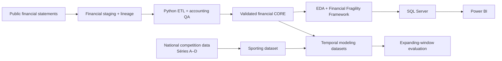
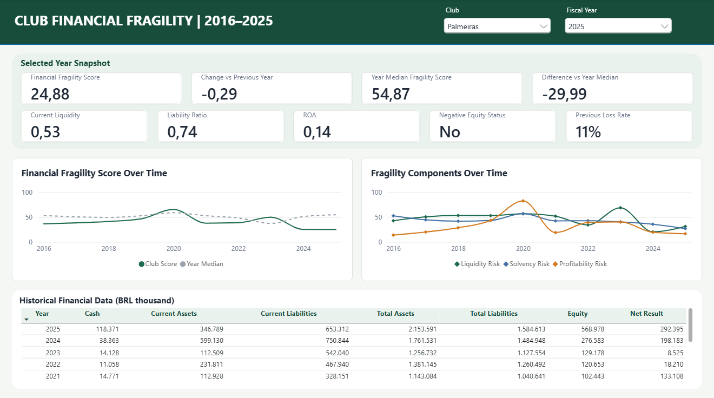
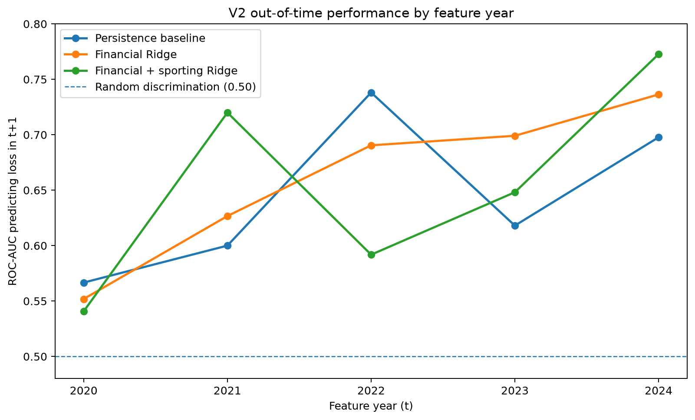

# Football Credit Risk

English | [Português](README.pt-BR.md)

Longitudinal financial fragility analytics for Brazilian football clubs using public financial statements, accounting harmonization, SQL Server, Power BI and temporally validated predictive experiments.

**Public-release scope:** The original third-party financial-statement PDFs and complete competition-level sporting tables are not redistributed here. The project's analytical datasets, code and results are included. See [data availability and source provenance](docs/public_data_release.md).

## Overview

Brazilian football clubs publish financial statements in very different formats and under changing legal and accounting structures. Building a comparable historical dataset therefore requires more than collecting reported numbers: account labels must be harmonized, reporting perimeters must be interpreted consistently, restatements must be tracked, and unsupported years must remain explicit gaps.

This project covers **35 clubs from 2016 to 2025** and builds a validated longitudinal financial panel from public statements. The resulting dataset supports three parts of the analysis:

- longitudinal analysis of liquidity, solvency and profitability;
- a retrospective Financial Fragility Framework with SQL Server and Power BI reporting;
- an exploratory out-of-time experiment on whether financial and sporting information from fiscal year `t` helps anticipate a negative accounting result in fiscal year `t+1`.

### Project at a glance

| | |
|---|---:|
| Clubs | **35** |
| Financial period | **2016–2025** |
| Potential club-years | **350** |
| Validated financial club-years | **339** |
| Documentary coverage | **96.9%** |
| Documentary gaps | **11** |
| Sporting observations | **1,256** |

### Main findings

- Annual median current liquidity stayed below 1 throughout 2016–2025.
- Liquidity and negative-equity incidence improved through 2023, then weakened in 2024–2025. Negative accounting results were reported in 73.5% of documented club-years in 2024 and 66.7% in 2025.
- In the predictive experiment, the financial logistic-regression specification with L2 regularization reached a mean external-fold ROC-AUC of **0.6609**, compared with **0.6441** for persistence. Adding sporting variables did not improve the financial specification on average, and Gradient Boosting performed worse than the logistic-regression specifications.

---

## 1. Scope and analytical design

The project addresses two related questions.

**Financial analysis**

> How has financial fragility evolved among the clubs in the study universe, based on comparable information extracted from public financial statements?

**Predictive extension**

> Does financial and sporting information from fiscal year `t` help predict whether a club reports a negative accounting result in fiscal year `t+1`?

A second predictive comparison tests whether sporting performance adds information beyond the financial variables.

The club universe contains the 35 clubs that appeared in Série A at least once during the 2016–2026 selection window. The analytical data end in 2025; the 2026 season is used only to determine universe membership.



**Stack:** Python, pandas, NumPy, scikit-learn, matplotlib, SQL Server, Power BI, Jupyter, BeautifulSoup, Playwright, Excel/CSV staging and Git/GitHub.

---

## 2. Financial data construction

### Source material and staging

The financial dataset was built from publicly available financial statements. The original PDFs are retained in a private research archive and are **not redistributed** in this public release. Each extracted value is recorded in the included staging workbook with its original account label, published value, unit and source filename. Rechecking an entry against the original publication requires obtaining that statement separately.

The staging schema has nine fields:

```text
club
fiscal_year
statement
account_original
value_original
unit
standard_variable
source_file
notes
```

`account_original` keeps the terminology used in the statement, while `standard_variable` maps that account to the project's harmonized financial concepts. This preserves a direct audit trail from the processed dataset back to the source document.

### Financial CORE

A club-year enters the analytical dataset only when all seven CORE variables are supported by the underlying documents:

| Variable | Definition |
|---|---|
| `cash` | Cash and immediately available financial resources |
| `current_assets` | Total current assets |
| `total_assets` | Total assets |
| `current_liabilities` | Total current liabilities |
| `total_liabilities` | Obligations excluding equity |
| `equity` | Equity for the selected reporting perimeter |
| `net_result` | Annual accounting profit or loss |

Values are standardized to **BRL thousands** in the processed dataset. The original published values and units remain in staging.

The harmonization rules favor directly published totals. Accounting-identical derivations are used only when all required components are explicitly available. Estimates, interpolation and balancing adjustments are excluded from the dataset.

### Reporting perimeter and SAF transitions

Legal structure changes are one of the main comparability issues in Brazilian football. Several clubs transferred professional football operations from an association to a SAF during the period, while others published consolidated statements that included controlled entities.

For each fiscal year, the selected reporting perimeter is the official entity or consolidated group that best represents the professional football operation. The treatment of association/SAF transitions, consolidated equity, non-controlling interests, partial reporting periods and formal restatements is documented in the staging history and in [`docs/data_dictionary_v2.md`](docs/data_dictionary_v2.md).

Consolidated values are used only when they are published for the selected reporting perimeter; separate Association and SAF statements are kept distinct.

### Coverage and validation

The target panel contains **350 potential club-years**. Of these, **339 are fully supported by the required financial information**, producing **96.9% documentary coverage**.

Eleven club-years remain documentary gaps:

<details>
<summary><strong>Documentary gaps</strong></summary>

- Cuiabá — 2016
- Mirassol — 2019
- CSA — 2025
- Figueirense — 2024, 2025
- Remo — 2016, 2017, 2018
- Vitória — 2017, 2018, 2019

</details>

The final CORE contains no missing CORE field in accepted rows and no duplicate `club × fiscal_year` key. The accounting identity

```text
total_assets = total_liabilities + equity
```

is checked with a tolerance of 1 BRL thousand for published rounding differences.

Canonical dataset: [`data/processed/core_financials.csv`](data/processed/core_financials.csv)  
Financial specification: [`docs/data_dictionary_v2.md`](docs/data_dictionary_v2.md)

---

## 3. Financial analysis and fragility framework

The descriptive analysis focuses on three dimensions that remain interpretable across clubs and years:

- **liquidity** — ability to cover short-term obligations;
- **solvency** — liabilities relative to the asset base;
- **profitability** — accounting return on assets.

Across the 339 documented club-years, the annual median current liquidity remained below 1 in every year. Negative equity was common throughout the period, although its incidence fell materially through 2023 before rising again in 2024 and 2025. Losses were also recurrent: **18 of the 35 clubs** reported a negative `net_result` in at least 60% of their observed years.

### Financial Fragility Framework

The framework uses three ratios:

```text
current_liquidity = current_assets / current_liabilities
liability_ratio   = total_liabilities / total_assets
return_on_assets  = net_result / total_assets
```

Each ratio is converted to a percentile risk component over the full 339-row retrospective reference sample:

```text
liquidity_risk     = (1 - rank_pct(current_liquidity)) × 100
solvency_risk      = rank_pct(liability_ratio) × 100
profitability_risk = (1 - rank_pct(return_on_assets)) × 100
```

The composite score is the arithmetic mean of the three components:

```text
financial_fragility_score =
    (liquidity_risk + solvency_risk + profitability_risk) / 3
```

`negative_equity` and `previous_loss_rate` are retained as contextual indicators outside the composite score. Equal weights keep the framework transparent and avoid imposing different importance across dimensions without a validated empirical basis for doing so.

Notebook 03 evaluates the stability of the framework under alternative weights and normalization. Giving one dimension 50% weight and the other two 25% produces Spearman correlations between **0.969 and 0.978** with the equal-weight ranking. A min–max normalization comparison produces a Spearman correlation of **0.897**.

The score supports retrospective comparison within the published 2016–2025 sample. Because the percentile reference uses the full period, earlier observations are ranked relative to later years as well; the score therefore reflects the fixed published sample rather than the information set available at each historical date.

Methodology: [`docs/fragility_framework.md`](docs/fragility_framework.md)  
Implementation and sensitivity analysis: [`notebooks/03_risk_framework.ipynb`](notebooks/03_risk_framework.ipynb)

---

## 4. SQL Server and Power BI

The complete fragility dataset is loaded into SQL Server and exposed to Power BI through a dashboard view.

The active SQL objects are:

- `dbo.financial_fragility_scores`
- `dbo.vw_financial_fragility_dashboard`

The view calculates the previous score and annual change only when the immediately preceding calendar year exists. This prevents a gap such as 2017 → 2019 from being displayed as a one-year movement.

```sql
CASE WHEN preceding_year = fiscal_year - 1
     THEN financial_fragility_score - preceding_score
END AS fragility_score_change
```

The Power BI report contains two pages:

- **Overview** — historical monitoring across the sample;
- **Club Detail** — club-level financial history, fragility components and selected-year context.



SQL scripts: [`sql/`](sql/)  
Power BI Project: [`powerbi/football_financial_fragility.pbip`](powerbi/football_financial_fragility.pbip)

---

## 5. Sporting data and predictive experiment

### Sporting data

The sporting dataset covers Série A, B, C and D from **2016 to 2025**, with **1,256 observations** across 40 competition-year combinations. Sources are primarily CBF and RSSSF Brasil, with UOL used for Série B 2016 as a documented exception.

Recorded variables include matches played, points, goals for and against, league position, league size and division. The processed dataset also contains:

- `points_per_game`
- `goal_difference_per_game`
- `relative_league_position`
- `promoted`
- `relegated`

For Séries C and D, where competition structures changed across years, the first qualifying stage is used to maintain a consistent season-level comparison.

The merge is anchored on the financial panel: **333 financial club-years match a sporting observation and six remain financial-only**.

Collection logic: [`src/collect_sporting_data.py`](src/collect_sporting_data.py)  
Integrated analytical snapshot: [`data/processed/financial_sporting_data.csv`](data/processed/financial_sporting_data.csv)

The complete competition-level sporting staging and processed tables (1,256 observations) are **not redistributed** in this public release. The merged club-year data and predictive features used for the reported analyses are included. The original competition-level inputs must be obtained separately for a full rebuild of the sporting collection and merge stages; consult the original providers' terms and [data availability notes](docs/public_data_release.md).

### Target

The predictive outcome is the accounting result in the following fiscal year:

```text
loss_next_year = 1 if net_result(t+1) < 0 else 0
```

Labels are created only for exact `t` → `t+1` pairs; observations separated by a gap do not form a labeled transition.

The benchmark is persistence:

```text
prediction = loss_current_year
```

Persistence provides a demanding benchmark because, within the observed sample, clubs reporting a loss in year `t` often remain in loss in year `t+1`.

### Longitudinal features

The initial snapshot specification did not outperform the persistence benchmark, motivating the addition of recent financial history in V2. The final V2 specification incorporates `previous_loss_rate` and exact-year changes in the three financial ratios.

**Financial features**

- `current_liquidity`
- `liability_ratio`
- `return_on_assets`
- `loss_current_year`
- `previous_loss_rate`
- `delta_current_liquidity`
- `delta_liability_ratio`
- `delta_return_on_assets`

**Sporting features**

- `division`
- `points_per_game`
- `goal_difference_per_game`
- `relative_league_position`
- `promoted`
- `relegated`

Financial deltas are calculated only when year `t-1` is observed. The common V2 sample contains **262 labeled observations**.

### Temporal validation

Model evaluation follows an expanding-window design. Every external test year occurs after the data used for training and hyperparameter selection.

| Training feature years through | Test feature year | Target year |
|---:|---:|---:|
| 2019 | 2020 | 2021 |
| 2020 | 2021 | 2022 |
| 2021 | 2022 | 2023 |
| 2022 | 2023 | 2024 |
| 2023 | 2024 | 2025 |

The main comparison uses logistic regression with L2 regularization and a restricted `GradientBoostingClassifier` benchmark. Hyperparameters are selected using earlier years inside each external fold. The principal metric is the mean ROC-AUC across the five external test years. Together, the five external folds contain **167 out-of-time predictions**.

Modeling notebooks: [`notebooks/08_build_modeling_dataset_v2.ipynb`](notebooks/08_build_modeling_dataset_v2.ipynb), [`notebooks/09_temporal_modeling_experiment_v2.ipynb`](notebooks/09_temporal_modeling_experiment_v2.ipynb), [`notebooks/10_nonlinear_v2_experiment.ipynb`](notebooks/10_nonlinear_v2_experiment.ipynb)

---

## 6. Predictive results

| Specification | Mean external ROC-AUC |
|---|---:|
| Persistence | **0.6441** |
| Financial logistic regression (L2) — V2 | **0.6609** |
| Financial + sporting logistic regression (L2) — V2 | **0.6547** |
| Financial Gradient Boosting | **0.5972** |
| Financial + sporting Gradient Boosting | **0.6117** |



The financial logistic-regression model produced the best average result, although the improvement over persistence was small. Adding sporting variables reduced mean AUC slightly, and the Gradient Boosting specifications performed below the logistic-regression models.

Performance varied considerably across test years, which limits the evidence for stable out-of-time performance. With only five external test years, small differences in mean ROC-AUC should not be treated as statistically established.

A sensitivity run excluding feature year 2020 preserved the ordering among persistence and the two logistic-regression specifications. In this sensitivity design, 2020 is removed as an external test feature year and is also excluded from the training history of later folds, rather than being deleted only after predictions are generated:

| Specification | Mean external ROC-AUC, excluding 2020 |
|---|---:|
| Persistence | **0.6635** |
| Financial logistic regression (L2) — V2 | **0.6794** |
| Financial + sporting logistic regression (L2) — V2 | **0.6698** |

A broader accounting feature set was also investigated, including revenue, operating result, financial result, financial expenses and personnel expenses. Coverage and accounting definitions were too inconsistent across clubs and early years to support a comparable longitudinal model, so these variables were not included in the final experiment.

Final results: [`notebooks/11_final_results_summary.ipynb`](notebooks/11_final_results_summary.ipynb)  
Figures: [`notebooks/12_final_results_figures.ipynb`](notebooks/12_final_results_figures.ipynb)

---

## 7. Quality assurance and reproducibility

Quality checks are implemented at the financial, analytical and SQL layers.

The pipeline verifies:

- unique `club × fiscal_year` keys;
- complete CORE variables in accepted club-years;
- valid ratio denominators;
- accounting identity within the defined tolerance;
- fragility-score range and percentile calculations;
- historical-loss calculations;
- consecutive-year logic in the SQL dashboard view.

Focused regression tests are available under [`tests/`](tests/):

```bash
python -m unittest discover -s tests
```

Install Python dependencies with:

```bash
pip install -r requirements.txt
```

This public release intentionally excludes the source PDFs and complete source-level sporting tables; **Git LFS is not required**. Notebooks `01`–`03` and `06`–`12` can be run using the included financial staging and processed datasets. Notebooks `04`–`05` require the omitted competition-level sporting inputs to reproduce the original extraction-to-merge sequence. Source-level verification of financial entries also requires independently obtaining the original statements. See [data availability and provenance](docs/public_data_release.md).

The sporting collector uses Edge or Chrome when available and can fall back to Playwright Chromium:

```bash
python -m playwright install chromium
```

The numbered notebooks document the analytical workflow from CORE construction through final figures. The full-history fragility outputs can also be rebuilt directly with:

```bash
python src/build_financial_fragility.py
```

Recreating the dashboard requires SQL Server, Windows PowerShell and Power BI Desktop. The SQL loading sequence is documented in [`scripts/load_fragility_sqlserver.ps1`](scripts/load_fragility_sqlserver.ps1) and the scripts under [`sql/`](sql/).

The financial source-to-staging step remains review-based because the source statements differ materially in layout, accounting terminology and reporting perimeter. The public release includes the accepted financial staging, processing code, validation logic and the processed analytical outputs. It does not reproduce the underlying third-party documents or the complete original sporting tables.

---

## 8. AI-assisted development

ChatGPT supported parts of the workflow, including documentary research, structured extraction, debugging, code review and documentation.

For structured extraction tasks, prompts specified the expected schema, permitted sources and rules for handling unsupported information. Financial extraction remained tied to the fixed staging schema and to source documents accepted into the project. Versioned handoff notes were used to keep data definitions and methodological decisions consistent across long-running AI-assisted sessions. Ambiguous or conflicting outputs were reviewed against the underlying source evidence before being accepted.

Final financial observations were accepted only after source review and deterministic QA. The predictive models, fragility calculations and reported results come from the repository's executed code and notebooks; no LLM is used as a feature, scoring component or predictive model.

---

## 9. Limitations

- The club universe is defined retrospectively using Série A participation through 2026. This affects sample composition, although 2026 information is not used as a model feature or target.
- Financial statement publication dates were not modeled. The out-of-time evaluation is based on fiscal years rather than exact point-in-time information availability.
- Eleven financial club-years remain unavailable under the project's documentary requirements.
- Association/SAF transitions, consolidation choices and differing reporting periods limit perfect comparability across all observations.
- The fragility score is retrospective and tied to the fixed 2016–2025 reference sample.
- The predictive target is a negative accounting result, which is different from default, bankruptcy or probability of default.
- The main predictive evaluation contains five external test years, limiting the precision of performance comparisons.
- Sporting comparisons across Série A–D require simplified common definitions, especially for Série C and Série D competition formats.
- The predictive analysis is associative; causal effects of sporting performance are outside its scope.

---

## 10. Repository guide

| Path | Contents |
|---|---|
| [`docs/public_data_release.md`](docs/public_data_release.md) | Public-data scope, exclusions and source provenance |
| [`data/staging/`](data/staging/) | Financial staging workbook (complete sporting staging excluded) |
| [`data/processed/`](data/processed/) | CORE, fragility, integrated and modeling datasets (full sporting table excluded) |
| [`docs/data_dictionary_v2.md`](docs/data_dictionary_v2.md) | Financial data specification |
| [`docs/fragility_framework.md`](docs/fragility_framework.md) | Fragility methodology |
| [`notebooks/`](notebooks/) | Ordered analytical workflow |
| [`src/`](src/) | Reusable processing and collection scripts |
| [`sql/`](sql/) | SQL Server tables, view and validation |
| [`tests/`](tests/) | Focused regression tests |
| [`powerbi/`](powerbi/) | Power BI Project |
| [`images/`](images/) | Figures and dashboard screenshots |

