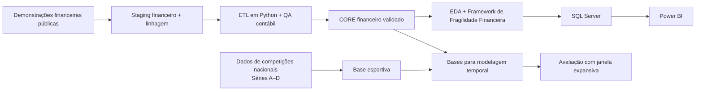

# Football Credit Risk

[English](README.md) | Português

Análise longitudinal de fragilidade financeira de clubes brasileiros de futebol a partir de demonstrações financeiras públicas, harmonização contábil, SQL Server, Power BI e experimentos preditivos com validação temporal.

**Escopo da versão pública:** Os PDFs originais dos demonstrativos de terceiros e as tabelas esportivas completas por competição não são redistribuídos aqui. As bases analíticas, o código e os resultados do projeto estão disponíveis. Veja [disponibilidade dos dados e proveniência das fontes](docs/public_data_release.md).

## Visão geral

Os clubes brasileiros de futebol publicam demonstrações financeiras em formatos muito diferentes e sob estruturas jurídicas e contábeis que mudam ao longo do tempo. Construir uma base histórica comparável, portanto, exige mais do que coletar valores reportados: os nomes das contas precisam ser harmonizados, os perímetros de reporte precisam ser interpretados de forma consistente, reapresentações precisam ser acompanhadas e anos sem suporte documental suficiente precisam permanecer como lacunas explícitas.

Este projeto cobre **35 clubes de 2016 a 2025** e constrói um painel financeiro longitudinal validado a partir de demonstrações públicas. A base resultante sustenta três partes da análise:

- análise longitudinal de liquidez, solvência e rentabilidade;
- um Framework de Fragilidade Financeira retrospectivo, com reporting em SQL Server e Power BI;
- um experimento preditivo exploratório out-of-time para investigar se dados financeiros e esportivos do exercício `t` ajudam a antecipar um resultado contábil negativo no exercício `t+1`.

### Visão geral do projeto

| | |
|---|---:|
| Clubes | **35** |
| Período financeiro | **2016–2025** |
| Combinações clube-ano potenciais | **350** |
| Combinações clube-ano financeiras validadas | **339** |
| Cobertura documental | **96,9%** |
| Lacunas documentais | **11** |
| Observações esportivas | **1.256** |

### Principais achados

- A mediana anual da liquidez corrente permaneceu abaixo de 1 em todos os anos de 2016 a 2025.
- A liquidez e a incidência de patrimônio líquido negativo melhoraram até 2023 e voltaram a piorar em 2024–2025. Resultados contábeis negativos foram observados em 73,5% das combinações clube-ano documentadas em 2024 e 66,7% em 2025.
- No experimento preditivo, a especificação financeira de regressão logística com regularização L2 alcançou ROC-AUC médio entre folds externos de **0,6609**, contra **0,6441** do baseline de persistência. A inclusão de variáveis esportivas não melhorou, em média, a especificação financeira, e Gradient Boosting apresentou desempenho inferior às especificações de regressão logística.

---

## 1. Escopo e desenho analítico

O projeto aborda duas perguntas relacionadas.

**Análise financeira**

> Como a fragilidade financeira evoluiu entre os clubes do universo do estudo, com base em informações comparáveis extraídas de demonstrações financeiras públicas?

**Extensão preditiva**

> Informações financeiras e esportivas referentes ao exercício `t` ajudam a prever se um clube registrará resultado contábil negativo no exercício `t+1`?

Uma segunda comparação preditiva testa se o desempenho esportivo acrescenta informação além das variáveis financeiras.

O universo contém os 35 clubes que disputaram a Série A ao menos uma vez durante a janela de seleção de 2016 a 2026. Os dados analíticos terminam em 2025; a temporada de 2026 é usada apenas para determinar a composição do universo.



**Stack:** Python, pandas, NumPy, scikit-learn, matplotlib, SQL Server, Power BI, Jupyter, BeautifulSoup, Playwright, staging em Excel/CSV e Git/GitHub.

---

## 2. Construção da base financeira

### Fontes e staging

A base financeira foi construída a partir de demonstrações financeiras públicas. Os PDFs originais permanecem em um arquivo privado de pesquisa e **não são redistribuídos** nesta versão pública. Cada valor extraído está registrado na planilha de staging incluída no repositório, com nome original da conta, valor publicado, unidade e nome do arquivo de origem. Para conferir um lançamento diretamente no documento, é necessário obter a publicação original separadamente.

O schema de staging contém nove campos:

```text
club
fiscal_year
statement
account_original
value_original
unit
standard_variable
source_file
notes
```

`account_original` preserva a terminologia usada na demonstração, enquanto `standard_variable` mapeia essa conta para os conceitos financeiros harmonizados do projeto. Isso mantém uma trilha de auditoria direta entre a base processada e o documento de origem.

### CORE financeiro

Uma combinação clube-ano entra na base analítica apenas quando todas as sete variáveis CORE estão sustentadas pelos documentos subjacentes:

| Variável | Definição |
|---|---|
| `cash` | Caixa e recursos financeiros de disponibilidade imediata |
| `current_assets` | Ativo circulante total |
| `total_assets` | Ativo total |
| `current_liabilities` | Passivo circulante total |
| `total_liabilities` | Obrigações excluindo patrimônio líquido |
| `equity` | Patrimônio líquido do perímetro de reporte selecionado |
| `net_result` | Lucro ou prejuízo contábil anual |

Os valores são padronizados em **milhares de BRL** na base processada. Os valores e unidades originais publicados permanecem no staging.

As regras de harmonização priorizam totais publicados diretamente. Derivações contabilmente idênticas são usadas somente quando todos os componentes necessários estão explicitamente disponíveis. Estimativas, interpolações e ajustes de balanceamento são excluídos da base.

### Perímetro de reporte e transições para SAF

Mudanças de estrutura jurídica estão entre os principais desafios de comparabilidade no futebol brasileiro. Vários clubes transferiram as operações do futebol profissional de uma associação para uma SAF durante o período, enquanto outros publicaram demonstrações consolidadas incluindo entidades controladas.

Para cada exercício, o perímetro selecionado é a entidade oficial ou grupo consolidado que melhor representa a operação do futebol profissional. O tratamento de transições associação/SAF, patrimônio líquido consolidado, participações de não controladores, períodos parciais de reporte e reapresentações formais está documentado no histórico de staging e em [`docs/data_dictionary_v2.md`](docs/data_dictionary_v2.md).

Valores consolidados são usados somente quando publicados para o perímetro de reporte selecionado; demonstrações separadas de Associação e SAF permanecem distintas.

### Cobertura e validação

O painel-alvo contém **350 combinações clube-ano potenciais**. Destas, **339 possuem suporte completo das informações financeiras exigidas**, resultando em **96,9% de cobertura documental**.

Onze combinações clube-ano permanecem como lacunas documentais:

<details>
<summary><strong>Lacunas documentais</strong></summary>

- Cuiabá — 2016
- Mirassol — 2019
- CSA — 2025
- Figueirense — 2024, 2025
- Remo — 2016, 2017, 2018
- Vitória — 2017, 2018, 2019

</details>

Nas linhas aceitas do CORE final, não há valores faltantes nas sete variáveis obrigatórias nem chaves `club × fiscal_year` duplicadas. A identidade contábil

```text
total_assets = total_liabilities + equity
```

é verificada com tolerância de 1 mil BRL para diferenças de arredondamento publicadas.

Base canônica: [`data/processed/core_financials.csv`](data/processed/core_financials.csv)  
Especificação financeira: [`docs/data_dictionary_v2.md`](docs/data_dictionary_v2.md)

---

## 3. Análise financeira e framework de fragilidade

A análise descritiva se concentra em três dimensões que permanecem interpretáveis entre clubes e anos:

- **liquidez** — capacidade de cobrir obrigações de curto prazo;
- **solvência** — passivos em relação à base de ativos;
- **rentabilidade** — retorno contábil sobre os ativos.

Nas 339 combinações clube-ano documentadas, a mediana anual da liquidez corrente permaneceu abaixo de 1 em todos os anos. O patrimônio líquido negativo foi comum ao longo do período, embora sua incidência tenha caído de forma relevante até 2023 antes de voltar a subir em 2024 e 2025. Prejuízos também foram recorrentes: **18 dos 35 clubes** reportaram `net_result` negativo em pelo menos 60% dos anos observados.

### Framework de Fragilidade Financeira

O framework utiliza três indicadores:

```text
current_liquidity = current_assets / current_liabilities
liability_ratio   = total_liabilities / total_assets
return_on_assets  = net_result / total_assets
```

Cada indicador é transformado em um componente de risco percentílico sobre a amostra retrospectiva completa de referência, com 339 linhas:

```text
liquidity_risk     = (1 - rank_pct(current_liquidity)) × 100
solvency_risk      = rank_pct(liability_ratio) × 100
profitability_risk = (1 - rank_pct(return_on_assets)) × 100
```

O score composto é a média aritmética dos três componentes:

```text
financial_fragility_score =
    (liquidity_risk + solvency_risk + profitability_risk) / 3
```

`negative_equity` e `previous_loss_rate` são mantidos como indicadores contextuais fora do score composto. Pesos iguais mantêm o framework transparente e evitam impor importâncias diferentes entre as dimensões sem uma base empírica validada para isso.

O Notebook 03 avalia a estabilidade do framework sob pesos e normalizações alternativas. Atribuir peso de 50% a uma dimensão e 25% às outras duas produz correlações de Spearman entre **0,969 e 0,978** em relação ao ranking com pesos iguais. Uma comparação com normalização min–max produz correlação de Spearman de **0,897**.

O score permite comparação retrospectiva dentro da amostra publicada de 2016–2025. Como a referência percentílica utiliza o período completo, observações de anos anteriores também são ranqueadas em relação a anos posteriores; portanto, o score reflete a amostra publicada fixa, e não o conjunto de informações disponível em cada data histórica.

Metodologia: [`docs/fragility_framework.md`](docs/fragility_framework.md)  
Implementação e análise de sensibilidade: [`notebooks/03_risk_framework.ipynb`](notebooks/03_risk_framework.ipynb)

---

## 4. SQL Server e Power BI

A base completa de fragilidade é carregada no SQL Server e disponibilizada ao Power BI por meio de uma view para dashboard.

Os objetos SQL ativos são:

- `dbo.financial_fragility_scores`
- `dbo.vw_financial_fragility_dashboard`

A view calcula o score anterior e a variação anual somente quando o ano-calendário imediatamente anterior existe. Isso evita que uma lacuna como 2017 → 2019 seja exibida como uma variação de um ano.

```sql
CASE WHEN preceding_year = fiscal_year - 1
     THEN financial_fragility_score - preceding_score
END AS fragility_score_change
```

O relatório no Power BI contém duas páginas:

- **Overview** — acompanhamento histórico da amostra;
- **Club Detail** — histórico financeiro por clube, componentes de fragilidade e contexto do ano selecionado.


Scripts SQL: [`sql/`](sql/)  
Projeto do Power BI: [`powerbi/football_financial_fragility.pbip`](powerbi/football_financial_fragility.pbip)

---

## 5. Dados esportivos e experimento preditivo

### Dados esportivos

A base esportiva cobre as Séries A, B, C e D de **2016 a 2025**, com **1.256 observações** em 40 combinações competição-ano. As fontes são principalmente CBF e RSSSF Brasil, com o UOL utilizado para a Série B de 2016 como exceção documentada.

As variáveis registradas incluem partidas disputadas, pontos, gols marcados e sofridos, posição na liga, tamanho da liga e divisão. A base processada também contém:

- `points_per_game`
- `goal_difference_per_game`
- `relative_league_position`
- `promoted`
- `relegated`

Para as Séries C e D, cujas estruturas de competição mudaram ao longo dos anos, é utilizada a primeira fase classificatória para manter uma comparação consistente em nível de temporada.

O merge é ancorado no painel financeiro: **333 combinações clube-ano financeiras encontram uma observação esportiva e seis permanecem apenas no lado financeiro**.

Lógica de coleta: [`src/collect_sporting_data.py`](src/collect_sporting_data.py)  
Base analítica integrada: [`data/processed/financial_sporting_data.csv`](data/processed/financial_sporting_data.csv)

As tabelas esportivas completas de staging e processamento por competição (1.256 observações) **não são redistribuídas** nesta versão pública. A base integrada por clube-ano e as features preditivas utilizadas nos resultados estão disponíveis. Para reconstruir a coleta esportiva e o merge desde a origem, é necessário obter separadamente as tabelas originais e observar as condições de uso de cada provedor. Veja as [notas de disponibilidade dos dados](docs/public_data_release.md).

### Target

O desfecho preditivo é o resultado contábil no exercício seguinte:

```text
loss_next_year = 1 if net_result(t+1) < 0 else 0
```

Os rótulos são criados somente para pares exatos `t` → `t+1`; observações separadas por uma lacuna não formam uma transição rotulada.

O benchmark é a persistência:

```text
prediction = loss_current_year
```

A persistência constitui um benchmark exigente porque, dentro da amostra observada, clubes que reportam prejuízo no ano `t` frequentemente permanecem em prejuízo no ano `t+1`.

### Features longitudinais

A especificação inicial, baseada em dados de um único exercício, não superou o baseline de persistência. Esse resultado motivou a inclusão de histórico financeiro recente na V2, que incorpora `previous_loss_rate` e variações dos três indicadores financeiros em relação ao exercício imediatamente anterior.

**Features financeiras**

- `current_liquidity`
- `liability_ratio`
- `return_on_assets`
- `loss_current_year`
- `previous_loss_rate`
- `delta_current_liquidity`
- `delta_liability_ratio`
- `delta_return_on_assets`

**Features esportivas**

- `division`
- `points_per_game`
- `goal_difference_per_game`
- `relative_league_position`
- `promoted`
- `relegated`

As variações financeiras são calculadas somente quando o ano `t-1` é observado. A amostra comum da V2 contém **262 observações rotuladas**.

### Validação temporal

A avaliação dos modelos segue um desenho de janela expansiva. Cada ano externo de teste ocorre depois dos dados usados para treinamento e seleção de hiperparâmetros.

| Treinamento: último ano das features | Teste: ano das features | Ano do resultado previsto |
|---:|---:|---:|
| 2019 | 2020 | 2021 |
| 2020 | 2021 | 2022 |
| 2021 | 2022 | 2023 |
| 2022 | 2023 | 2024 |
| 2023 | 2024 | 2025 |

A comparação principal utiliza regressão logística com regularização L2 e um benchmark restrito de `GradientBoostingClassifier`. Os hiperparâmetros são selecionados usando anos anteriores dentro de cada fold externo. A métrica principal é a média do ROC-AUC entre os cinco anos externos de teste. Em conjunto, os cinco folds externos contêm **167 previsões out-of-time**.

Notebooks de modelagem: [`notebooks/08_build_modeling_dataset_v2.ipynb`](notebooks/08_build_modeling_dataset_v2.ipynb), [`notebooks/09_temporal_modeling_experiment_v2.ipynb`](notebooks/09_temporal_modeling_experiment_v2.ipynb), [`notebooks/10_nonlinear_v2_experiment.ipynb`](notebooks/10_nonlinear_v2_experiment.ipynb)

---

## 6. Resultados preditivos

| Especificação | ROC-AUC médio externo |
|---|---:|
| Persistência | **0,6441** |
| Regressão logística financeira (L2) — V2 | **0,6609** |
| Regressão logística financeira + esportiva (L2) — V2 | **0,6547** |
| Gradient Boosting financeiro | **0,5972** |
| Gradient Boosting financeiro + esportivo | **0,6117** |


O modelo de regressão logística financeira apresentou o melhor resultado médio, embora a melhora em relação à persistência tenha sido pequena. A inclusão de variáveis esportivas reduziu ligeiramente o AUC médio, e as especificações com Gradient Boosting ficaram abaixo dos modelos de regressão logística.

O desempenho variou de forma considerável entre os anos de teste, o que limita a evidência de desempenho out-of-time estável. Com apenas cinco anos externos de teste, pequenas diferenças no ROC-AUC médio não devem ser tratadas como estatisticamente estabelecidas.

Uma análise de sensibilidade que exclui 2020 como ano das features preservou a ordenação entre a persistência e as duas especificações de regressão logística. Nessa análise, 2020 é retirado do teste externo e também do histórico de treinamento dos folds posteriores, antes da geração das previsões:

| Especificação | ROC-AUC médio externo, excluindo 2020 |
|---|---:|
| Persistência | **0,6635** |
| Regressão logística financeira (L2) — V2 | **0,6794** |
| Regressão logística financeira + esportiva (L2) — V2 | **0,6698** |

Um conjunto contábil mais amplo também foi investigado, incluindo receita, resultado operacional, resultado financeiro, despesas financeiras e despesas com pessoal. A cobertura e as definições contábeis eram inconsistentes demais entre clubes e nos anos iniciais para sustentar um modelo longitudinal comparável, por isso essas variáveis não foram incluídas no experimento final.

Resultados finais: [`notebooks/11_final_results_summary.ipynb`](notebooks/11_final_results_summary.ipynb)  
Figuras: [`notebooks/12_final_results_figures.ipynb`](notebooks/12_final_results_figures.ipynb)

---

## 7. Garantia de qualidade e reprodutibilidade

As verificações de qualidade são implementadas nas camadas financeira, analítica e SQL.

O pipeline verifica:

- chaves `club × fiscal_year` únicas;
- variáveis CORE completas nas combinações clube-ano aceitas;
- denominadores válidos nos indicadores;
- identidade contábil dentro da tolerância definida;
- faixa do score de fragilidade e cálculos percentílicos;
- cálculos do histórico de prejuízos;
- lógica de anos consecutivos na view SQL do dashboard.

Testes de regressão focados estão disponíveis em [`tests/`](tests/):

```bash
python -m unittest discover -s tests
```

Instale as dependências Python com:

```bash
pip install -r requirements.txt
```

Esta versão pública exclui intencionalmente os PDFs de origem e as tabelas esportivas completas; **Git LFS não é necessário**. Os notebooks `01`–`03` e `06`–`12` podem ser executados com o staging financeiro e as bases processadas incluídas. Os notebooks `04`–`05` exigem os dados esportivos completos, não redistribuídos, para refazer a sequência original de coleta e integração. A conferência de lançamentos financeiros contra os documentos também requer acesso independente às demonstrações originais. Consulte [disponibilidade e proveniência](docs/public_data_release.md).

O coletor esportivo utiliza Edge ou Chrome quando disponíveis e pode recorrer ao Chromium do Playwright:

```bash
python -m playwright install chromium
```

Os notebooks numerados documentam o fluxo analítico desde a construção do CORE até as figuras finais. Os resultados de fragilidade do histórico completo também podem ser gerados novamente com:

```bash
python src/build_financial_fragility.py
```

A recriação do dashboard exige SQL Server, Windows PowerShell e Power BI Desktop. A sequência de carga no SQL está documentada em [`scripts/load_fragility_sqlserver.ps1`](scripts/load_fragility_sqlserver.ps1) e nos scripts em [`sql/`](sql/).

A extração e a harmonização iniciais das demonstrações financeiras exigem revisão humana, devido às diferenças de formato, terminologia contábil e perímetro de reporte entre as fontes. A versão pública inclui o staging financeiro aceito, o código de processamento, as validações e as bases analíticas processadas. Não reproduz os documentos originais de terceiros nem as tabelas esportivas integrais.

---

## 8. Desenvolvimento assistido por IA

O ChatGPT foi utilizado em algumas etapas do projeto, incluindo pesquisa documental, apoio à extração estruturada, depuração e revisão de código e preparação da documentação.

Nas tarefas de extração estruturada, os prompts definiam os campos esperados, as fontes permitidas e o tratamento de informações sem suporte documental. A extração financeira seguia o schema fixo de staging e utilizava os documentos de origem aceitos no projeto. Notas de continuidade versionadas (handoffs) ajudaram a manter as definições de dados e as decisões metodológicas consistentes entre as sessões com assistência de IA. Resultados ambíguos ou conflitantes eram conferidos com as respectivas fontes antes de serem aceitos.

As observações financeiras finais eram aceitas somente após conferência das fontes e verificações determinísticas de qualidade. Os modelos preditivos, os cálculos de fragilidade e os resultados apresentados provêm do código e dos notebooks executados no repositório; nenhum LLM participa como variável explicativa, componente do score ou modelo preditivo.

---

## 9. Limitações

- O universo de clubes é definido retrospectivamente usando participação na Série A até 2026. Isso afeta a composição da amostra, embora informações de 2026 não sejam usadas como feature nem como target.
- As datas de publicação das demonstrações financeiras não foram modeladas. A avaliação out-of-time considera os exercícios fiscais, sem reconstruir a disponibilidade exata das informações em cada data.
- Onze combinações clube-ano financeiras permanecem indisponíveis segundo os requisitos documentais do projeto.
- Transições Associação/SAF, escolhas de consolidação e diferenças nos períodos de reporte limitam a comparabilidade perfeita entre todas as observações.
- O score de fragilidade é retrospectivo e está vinculado à amostra fixa de referência de 2016–2025.
- O target preditivo é um resultado contábil negativo, diferente de default, falência ou probabilidade de default.
- A avaliação preditiva principal contém cinco anos externos de teste, limitando a precisão das comparações de desempenho.
- Comparações esportivas entre as Séries A–D exigem definições comuns simplificadas, especialmente nos formatos de competição das Séries C e D.
- A análise preditiva é associativa; efeitos causais do desempenho esportivo estão fora do escopo.

---

## 10. Guia do repositório

| Caminho | Conteúdo |
|---|---|
| [`docs/public_data_release.md`](docs/public_data_release.md) | Escopo da versão pública, exclusões e proveniência das fontes |
| [`data/staging/`](data/staging/) | Staging financeiro (staging esportivo completo não incluído) |
| [`data/processed/`](data/processed/) | CORE, fragilidade, integração e modelagem (tabela esportiva integral não incluída) |
| [`docs/data_dictionary_v2.md`](docs/data_dictionary_v2.md) | Especificação dos dados financeiros |
| [`docs/fragility_framework.md`](docs/fragility_framework.md) | Metodologia de fragilidade |
| [`notebooks/`](notebooks/) | Fluxo analítico ordenado |
| [`src/`](src/) | Scripts reutilizáveis de processamento e coleta |
| [`sql/`](sql/) | Tabelas, view e validação no SQL Server |
| [`tests/`](tests/) | Testes de regressão focados |
| [`powerbi/`](powerbi/) | Projeto do Power BI |
| [`images/`](images/) | Figuras e screenshots do dashboard |
